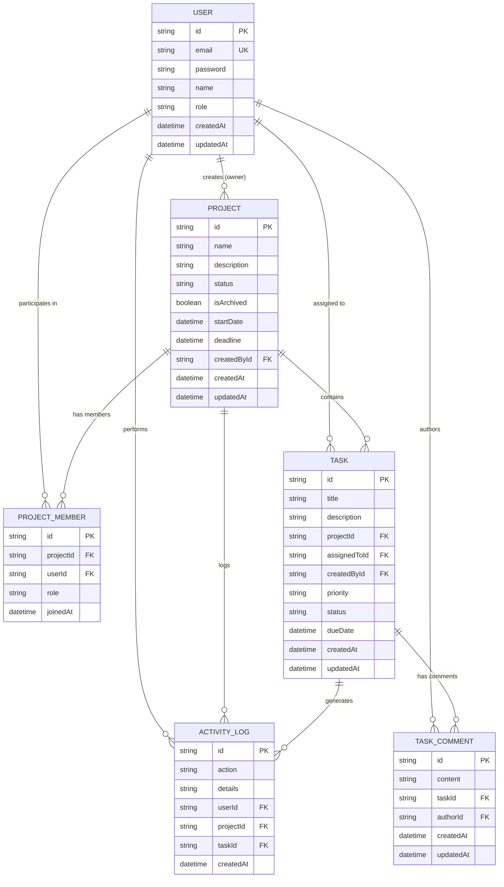

# PinkSync — Advanced Project & Team Management System
> **Pink & White Edition** | Full-Stack Web Application (React + TypeScript + Node.js + Express + Prisma ORM)

---

## 🌸 Overview

**PinkSync** is an enterprise-grade Project & Team Management System designed for modern product and engineering teams. Built with a bespoke **Pink and White** aesthetic, it delivers a high-contrast, delightful user experience while strictly enforcing role-based permissions, data scoping, and relational data integrity on both frontend and backend.

### Core Capabilities
- **Strict Role-Based Access Control (RBAC):** Distinct capability levels for **Admin**, **Project Manager**, and **Team Member** enforced at the database query level, not just UI visibility.
- **Project Lifecycle Management:** Create, update, filter, sort, and archive projects with dynamic progress calculation based on real-time task completion.
- **Task Management & Interactive Kanban Board:** Drag-and-drop workflow across `To Do`, `In Progress`, `In Review`, and `Done` states, complete with priority indicators, due dates, and assignees.
- **Contextual Collaboration:** Threaded comments on tasks and activity audit logs capturing assignments, status changes, and project updates.
- **Live Database-Driven Dashboard:** Real-time metrics on project counts, completion percentage, overdue tasks, and personalized assignments computed directly from the database.
- **Robust Security & Performance:** Password hashing via bcrypt, stateless JWT authentication, IP-based brute force protection, Zod validation, indexed queries, and database-backed pagination.

---

## 🛠️ Technology Stack & Rationale

| Layer | Technology | Rationale & Architectural Choice |
| :--- | :--- | :--- |
| **Frontend** | React 18 + TypeScript + Vite | Component modularity, strong typing, fast HMR build cycles, and zero runtime overhead. |
| **Styling** | Tailwind CSS + Lucide Icons | Responsive layout, custom pink-and-white color palette (`rose` / `pink` / `white`), custom scrollbars, and accessible badges. |
| **Backend** | Node.js + Express + TypeScript | Lightweight, scalable asynchronous event-driven I/O with clear separation of routes, controllers, middleware, and services. |
| **ORM & Database** | Prisma ORM with SQLite (PostgreSQL compatible) | Type-safe query building, migration management, and zero-configuration local reproducibility without requiring external DB servers. |
| **Authentication** | JWT (JSON Web Tokens) + Bcrypt.js | Stateless authorization with 7-day token expiry, salted password hashes (10 rounds), and Bearer token headers. |
| **Validation** | Zod | Runtime schema validation for requests (body, query params) with formatted error responses. |
| **Testing** | Vitest + Supertest | Blazing fast integration test execution for APIs, RBAC logic, data scoping, and edge cases. |

---

## 👥 Roles & Permissions Matrix

| Capability / Resource | Administrator (`ADMIN`) | Project Manager (`PROJECT_MANAGER`) | Team Member (`TEAM_MEMBER`) |
| :--- | :---: | :---: | :---: |
| **View Dashboard Metrics** | ✅ Global Scope | ✅ Authorized Projects Scope | ✅ Authorized Projects Scope |
| **Create Projects** | ✅ | ✅ | ❌ (403 Forbidden) |
| **Edit / Archive / Delete Project** | ✅ All Projects | ✅ Projects they created/manage | ❌ (403 Forbidden) |
| **Manage Project Members** | ✅ All Projects | ✅ Their Projects | ❌ (403 Forbidden) |
| **View Project Details** | ✅ All Projects | ✅ Member or Creator | ✅ If Member |
| **Create Tasks** | ✅ All Projects | ✅ Authorized Projects | ❌ / Only in assigned projects |
| **Update Task Details (title, due date)** | ✅ | ✅ Authorized Projects | ❌ (Can update status of assigned tasks) |
| **Update Task Status (`TODO` -> `DONE`)** | ✅ | ✅ | ✅ Assigned tasks & project tasks |
| **Delete Tasks** | ✅ | ✅ Authorized Projects | ❌ (403 Forbidden) |
| **Add Comments on Tasks** | ✅ | ✅ Authorized Projects | ✅ Authorized / Assigned Tasks |
| **Manage User Roles** | ✅ | ❌ | ❌ |

---

## 🗄️ Database Design & Entity Relationship (ER) Diagram



---

## ⚡ Quick Start Guide (One-Step Setup)

### 1. Prerequisites
- **Node.js** v18+ (tested on Node v20.18.0)
- **npm** v9+ (tested on npm 10.8.2)
- **Git**

### 2. Clone and Install Dependencies
From the repository root, install dependencies for all workspaces with a single command:

```bash
# Clone repository
git clone <repo-url>
cd project

# Install root, backend, and frontend dependencies
npm run install:all
```

### 3. Initialize Database & Seed Demo Data
Push the Prisma schema to generate the local SQLite database and seed realistic demo records:

```bash
# In the root or server directory:
npm run seed
```

### 4. Start the Application
Run both backend and frontend concurrently:

```bash
npm run dev
```

- **Frontend Application:** [http://localhost:5173](http://localhost:5173)
- **Backend REST API:** [http://localhost:5000/api](http://localhost:5000/api)
- **Health Check:** [http://localhost:5000/api/health](http://localhost:5000/api/health)

---

## 🔑 Demo Accounts & Pre-Seeded Credentials

The database seeder pre-configures 3 realistic accounts across different roles with a unified password:

| Role | Name | Email | Password |
| :--- | :--- | :--- | :--- |
| **Administrator** | Elena Rostova | `admin@projecthub.com` | `Password123!` |
| **Project Manager** | Sarah Connor | `pm@projecthub.com` | `Password123!` |
| **Team Member** | Chloe Bennett | `member@projecthub.com` | `Password123!` |

> 💡 **Quick Login:** The Login screen features 1-click autofill buttons for Admin, Manager, and Member to quickly test role permissions.

---

## 📡 RESTful API Documentation

All protected endpoints require an HTTP header: `Authorization: Bearer <JWT_TOKEN>`.

### Authentication Endpoints (`/api/auth`)
| Method | Endpoint | Description | Request Body | Status Code |
| :--- | :--- | :--- | :--- | :---: |
| `POST` | `/api/auth/register` | Register new user account | `{ name, email, password, role? }` | `201 Created` |
| `POST` | `/api/auth/login` | Authenticate user & issue JWT | `{ email, password }` | `200 OK` |
| `GET` | `/api/auth/me` | Fetch active authenticated profile | None | `200 OK` |
| `POST` | `/api/auth/logout` | Client logout hook | None | `200 OK` |

### Projects Endpoints (`/api/projects`)
| Method | Endpoint | Description | Query / Body Params | Access |
| :--- | :--- | :--- | :--- | :--- |
| `GET` | `/api/projects` | List projects with progress & task count | `page`, `limit`, `status`, `search`, `sortBy` | Scoped to user |
| `POST` | `/api/projects` | Create a new project | `{ name, description, status, startDate, deadline, memberIds }` | `ADMIN`, `PROJECT_MANAGER` |
| `GET` | `/api/projects/:id` | Get project details, members, tasks, logs | None | Project Members & Admin |
| `PATCH` | `/api/projects/:id` | Update project metadata or status | `{ name, description, status, deadline, isArchived }` | Owner PM & Admin |
| `DELETE`| `/api/projects/:id` | Delete project and cascade relations | None | Owner PM & Admin |
| `POST` | `/api/projects/:id/members` | Add member to project | `{ userId, role }` | Owner PM & Admin |
| `DELETE`| `/api/projects/:id/members/:userId` | Remove member from project | None | Owner PM & Admin |

### Tasks Endpoints (`/api/tasks`)
| Method | Endpoint | Description | Query / Body Params | Access |
| :--- | :--- | :--- | :--- | :--- |
| `GET` | `/api/tasks` | List & filter tasks | `projectId`, `assignedToId`, `status`, `priority`, `search`, `page` | Scoped to user |
| `POST` | `/api/tasks` | Create task in project | `{ title, description, projectId, assignedToId, priority, status, dueDate }` | Authorized Project User |
| `GET` | `/api/tasks/:id` | Get task details, comments, history | None | Authorized Project User |
| `PATCH` | `/api/tasks/:id` | Update task details or change status | `{ title, description, priority, status, assignedToId, dueDate }` | Admin/PM (all) or Assignee (status) |
| `DELETE`| `/api/tasks/:id` | Delete task | None | Admin & PM |
| `POST` | `/api/tasks/:id/comments` | Add comment on task | `{ content }` | Authorized Project User |

### Dashboard & Users (`/api/dashboard`, `/api/users`)
| Method | Endpoint | Description | Query / Body Params | Access |
| :--- | :--- | :--- | :--- | :--- |
| `GET` | `/api/dashboard/summary` | Real-time aggregated workspace statistics | None | Authenticated Users |
| `GET` | `/api/users` | Directory of team members | `role`, `search` | Authenticated Users |
| `PATCH` | `/api/users/:id/role` | Update user role | `{ role: 'ADMIN' \| 'PROJECT_MANAGER' \| 'TEAM_MEMBER' }` | `ADMIN` Only |

---

## 🧪 Automated Testing

Automated tests are written with **Vitest** and **Supertest** covering:
- ✅ Successful and unsuccessful login scenarios
- ✅ Required field validation (Zod validation schemas)
- ✅ Project and task creation workflows
- ✅ Task status updates & drag-and-drop status persistence
- ✅ Role-based permissions (verifying Team Member cannot create/delete projects)
- ✅ Prevention of unauthorized access to projects where user is not a member
- ✅ Task filtering by status/priority, pagination, and title search
- ✅ Dashboard metrics aggregation directly from DB

### Running Tests
Execute the test suite with:

```bash
# Run tests from root
npm test

# Or directly in server folder
npm --prefix server run test
```

**Test Output:**
```
✓ tests/auth.test.ts (8 tests)
✓ tests/projects.test.ts (6 tests)
✓ tests/tasks.test.ts (7 tests)

Test Files  3 passed (3)
     Tests  21 passed (21)
```

---

## 🛡️ Security & Performance Highlights

1. **Password Security:** Hashes stored using `bcryptjs` with 10 salt rounds. Passwords are never returned in queries or API responses.
2. **Brute Force Rate Limiting:** Configured with `express-rate-limit` allowing a maximum of 15 authentication attempts per 15-minute window for `/api/auth/*`.
3. **Strict Data Scoping:** Non-admin users are strictly scoped in database queries to only retrieve projects and tasks where they are creators or registered members.
4. **Database Query Optimization:** Foreign keys and frequently queried fields (`email`, `status`, `projectId`, `assignedToId`, `dueDate`) are indexed.
5. **Database-Backed Pagination:** Queries use `skip` and `take` with total counts computed via `prisma.project.count()` to prevent memory bottlenecks.
6. **Centralized Error Handling:** All errors pass through custom error middleware, logging safely to standard output without exposing stack traces in production.

---

## 📋 Technical Interview & Walkthrough Guide

### Q1: Why did you choose this architecture and SQLite with Prisma?
> **Answer:** The system uses a clean decoupled architecture separating routing, middleware, controllers, and data layers. Prisma ORM was chosen because it provides end-to-end TypeScript type safety, automated migration management, and relational mapping. SQLite was configured by default because it runs zero-configuration on any reviewer's machine without external database server prerequisites. Prisma allows seamless migration to PostgreSQL or MySQL simply by altering the `provider` in `schema.prisma`.

### Q2: How does Role-Based Authorization work across layers?
> **Answer:** Role-based access control is enforced at the backend through `requireRoles('ADMIN', 'PROJECT_MANAGER')` middleware and the `canAccessProject` / `canManageProject` database validation helpers. Even if an attacker inspects network traffic or sends API requests using cURL/Postman, the backend validates their session token, queries the membership table, and rejects unauthorized access with HTTP 403 Forbidden.

### Q3: How is task progress and dashboard data calculated?
> **Answer:** Instead of hardcoded or client-side averages, the dashboard executes database aggregate and count queries (`prisma.task.count({ where: ... })`) scoped to the user's authorized projects. Project completion rate is computed as `Math.round((completedTasks / totalTasks) * 100)`.

---

## 🚀 Known Limitations & Future Roadmap

1. **File Attachments:** Task comments and deliverables can be enhanced with S3 or local bucket file uploads.
2. **WebSocket Real-time Sync:** Socket.io integration can push instantaneous Kanban board updates across multiple concurrent browser tabs.
3. **Email Notifications:** Nodemailer integration for automated email alerts when a task deadline is within 24 hours.
